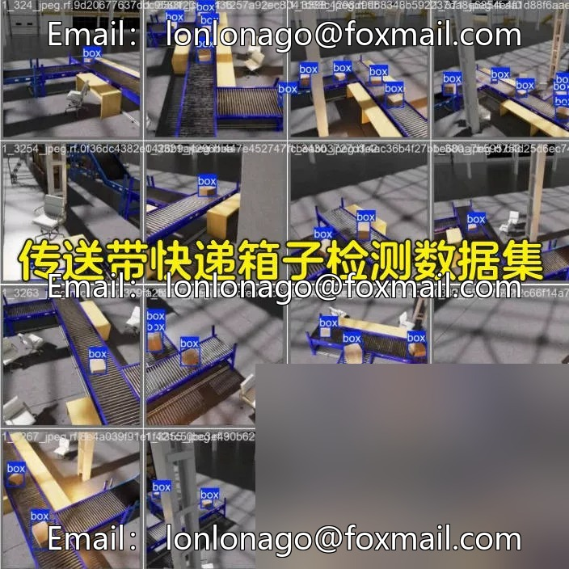
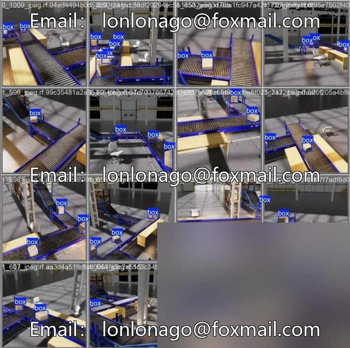
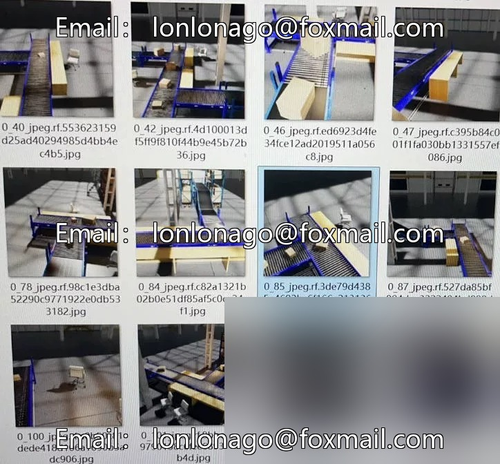
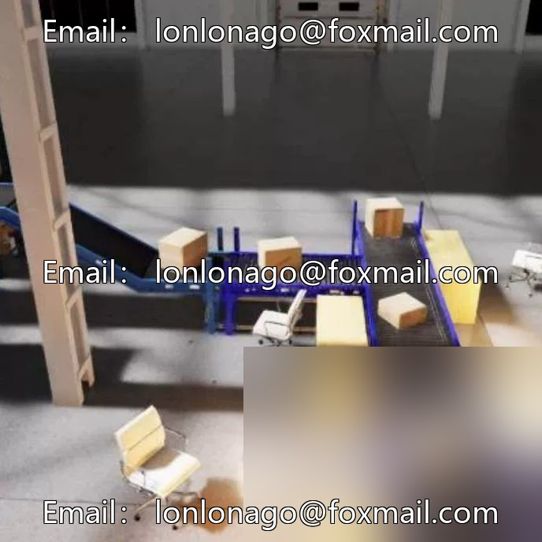

# Transfer belt express box detection dataset of 10,000

## Body

Transferred belt express box detection dataset of 10,000 samples
nc: 1
names: ['box']
name: ['box']
Total 10,000 samples, divided into 8:1:1 proportion
train: 8,000 samples, val: 1,000 samples, test: 1,000 samples
Annotation files are in YOLO-acceptable txt or xml format, and can be directly used for model training.

web-based shipment, can be directly photographed and shipped.

The dataset contains 10,000 conveyor belt express box detection samples with naming, ratio breakdown and YOLO-compatible formats; additional configuration and image resources are available.

<!-- AI_ENRICHED -->

## Images

## Payment

Here is a pay link on Stripe ( https://buy.stripe.com/3cs8yP7sY87d0vu9AB ). Please contact me lonlonago@foxmail.com after funding $89, and I will send you a complete data files , thank you!

